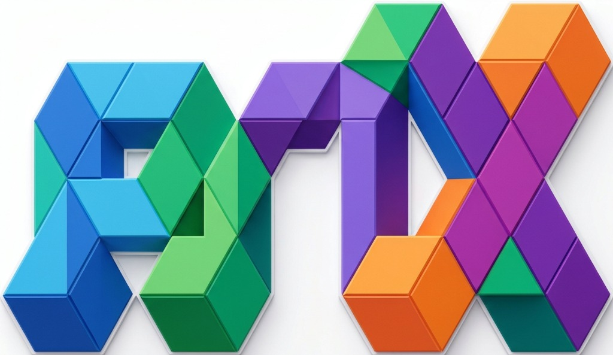
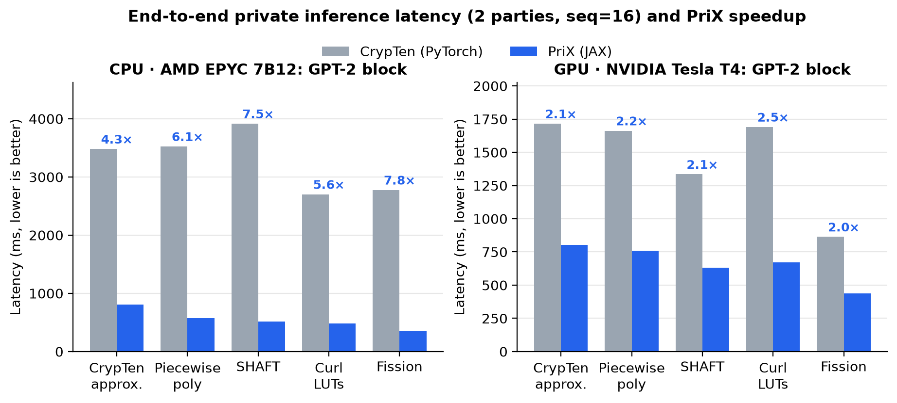
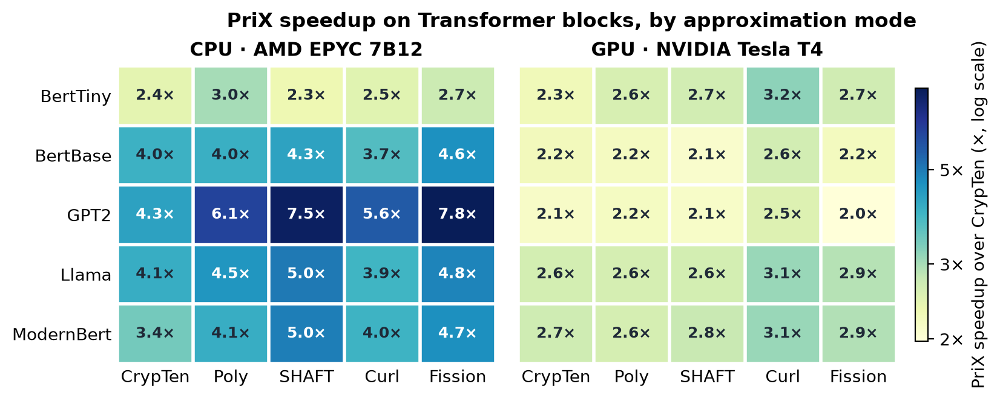
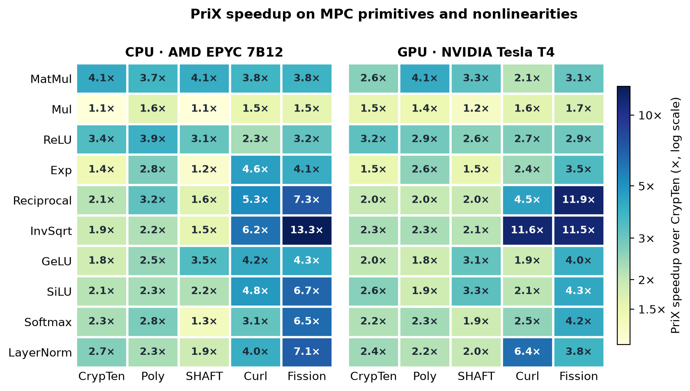
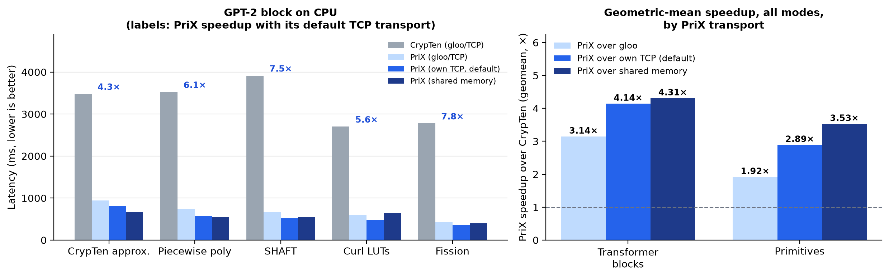

<p align="center"></p>

[](https://pypi.org/project/prix-jax/)
[](https://github.com/mugurbil/prix/actions/workflows/tests.yml)
[](https://colab.research.google.com/github/mugurbil/prix/blob/main/examples/prix_vs_curl_gpu_colab.ipynb)
[](https://github.com/mugurbil/prix/blob/main/LICENSE)
[](https://github.com/mugurbil/prix/blob/main/CONTRIBUTING.md)
--------------------------------------------------------------------------------

**PriX** is a **modern, high-performance JAX/XLA drop-in alternative to [CrypTen (NeurIPS 2021)](https://proceedings.neurips.cc/paper/2021/hash/2754518221cfbc8d25c13a06a4cb8421-Abstract.html)** built for **Private Machine Learning and Private LLM / Transformer Research** via Secure Multi-Party Computation (MPC).

Write familiar JAX/PyTorch-style Python (`prix.array`, `@prix.mpc.run_multiprocess`, `prix.nn.Module`, `.reconstruct()` / `.get_plain_text()`) while running on modern **Python 3.10–3.13** and **XLA (tested on CPU and CUDA GPU)**—and switch between five state-of-the-art MPC approximation paradigms ([**Curl (CAMLIS 2024)**](https://eprint.iacr.org/2024/1127), [**PUMA (2023)**](https://arxiv.org/abs/2307.12533) / [**Nimbus (NeurIPS 2024)**](https://arxiv.org/abs/2411.15707), [**SHAFT (NDSS 2025)**](https://www.ndss-symposium.org/ndss-paper/shaft-secure-handy-accurate-and-fast-transformer-inference/), [**CrypTen (NeurIPS 2021)**](https://arxiv.org/abs/2109.00984), and [**Fission (IEEE CNS 2025)**](https://eprint.iacr.org/2025/653)) with a single argument (`mode="lut" | "poly" | "shaft" | "crypten" | "fission"`).

> [!WARNING]
> **Research prototype — not yet suitable for protecting real secrets.**
> - The share/triple PRNG is SplitMix64 (GPU) / PCG64 (CPU), which is fast but **not a cryptographically secure PRF**; a party that learns some outputs can predict the stream. A keyed CSPRNG (e.g. Threefry/AES-CTR) is planned.
> - The default `TFP` (Trusted First Party) provider lets party 0 generate all correlated randomness, so **party 0 can learn every secret** (as in CrypTen). Use it for benchmarking only; `TTP` assumes a non-colluding dealer.
> - Security is semi-honest (honest-but-curious) only.

---

## Why PriX over CrypTen?

Original [CrypTen (NeurIPS 2021)](https://github.com/facebookresearch/CrypTen) pioneered ML-friendly MPC in PyTorch, but its repository was archived in May 2025 and needs compatibility patches to run on current Python, PyTorch and JAX releases, while recent MPC breakthroughs—[Curl (CAMLIS 2024)](https://eprint.iacr.org/2024/1127), [PUMA (2023)](https://arxiv.org/abs/2307.12533) / [Nimbus (NeurIPS 2024)](https://arxiv.org/abs/2411.15707), [SHAFT (NDSS 2025)](https://www.ndss-symposium.org/ndss-paper/shaft-secure-handy-accurate-and-fast-transformer-inference/), and [Fission (IEEE CNS 2025)](https://eprint.iacr.org/2025/653)—live in separate repositories ([jimouris/curl](https://github.com/jimouris/curl), [secretflow/spu](https://github.com/secretflow/spu), [andeskyl/SHAFT](https://github.com/andeskyl/SHAFT)). **PriX** unifies all five in a single, actively maintained JAX/XLA package:

| Feature | CrypTen (PyTorch) | **PriX (JAX/XLA)** |
|---|---|---|
| **Python & Accelerator Support** | Archived (May 2025); needs patches for current Python / PyTorch | **Python 3.10–3.13**, **CPU & CUDA GPU** (tested) via `pip install prix-jax` |
| **API Ergonomics** | `crypten.cryptensor`, `@run_multiprocess`, `crypten.nn` | **`prix.array`, `@prix.mpc.run_multiprocess`, `prix.nn`** (plus drop-in `prix.cryptensor` alias) |
| **Nonlinear Approximation Backends** | Polynomial / NR / limit only (or separate forks) | **5 built-in backends in 1 line** (`mode="lut" \| "poly" \| "shaft" \| "crypten" \| "fission"`) |
| **Kernel Execution** | Eager PyTorch op-by-op launches | **`@jax.jit`-compiled local protocol steps** (fused carry-lookahead rounds, LUT gather, limb matmul, Fourier combination) |
| **Performance (single host, CPU & GPU)** | Baseline (`1.0x`) | Lower latency in every configuration measured. LLM blocks: **2.8x–9.2x faster on CPU**, **2.0x–3.2x faster on GPU**. Primitives: 1.8x–20.8x on CPU, 1.4x–16.2x on GPU ([details](#benchmarks-prix-jax-vs-crypten-pytorch)) |


<p align="center"></p>

---

## Installation

Install from PyPI:
```bash
pip install prix-jax
```

Or install from source:
```bash
git clone https://github.com/mugurbil/prix.git
cd prix
pip install -e .
```

---

## 30-Second Quickstart for Researchers

### 1. Secret Sharing & Multi-Party Computation

If you know JAX, PyTorch, or CrypTen, you already know PriX. Decorate any function with `@prix.mpc.run_multiprocess` (or call `prix.run(fn, ...)`), secret-share tensors with `prix.array(...)` (or `prix.cryptensor(...)`), and reconstruct with `.reconstruct()` (or `.get_plain_text()`):

```python
import prix

@prix.mpc.run_multiprocess(world_size=2, mode="shaft")
def private_inference_demo():
    # Party 0 secret-shares input x; Party 1 secret-shares weights w
    x = prix.array([[1.0, -0.5, 2.0]], src=0)
    w = prix.array([[0.5, 1.0], [-1.0, 0.25], [0.8, -0.5]], src=1)

    # Private matrix multiplication + nonlinear activations under MPC
    logits = (x @ w).gelu()
    probs = logits.softmax(dim=-1)

    # Reconstruct plaintext result (or use .get_plain_text())
    return probs.reconstruct()

print("Decrypted probabilities:", private_inference_demo())
```

### 2. One-Line Ablations Across MPC Approximation Paradigms

Running ablation studies for a paper? Switch between all five MPC nonlinear approximation backends using `mode=` (or `prix.set_mode(...)`) without touching your model code:

```python
import prix

def eval_gelu():
    x = prix.array([-2.0, -0.5, 0.0, 0.5, 2.0])
    return x.gelu().reconstruct()

for mode in ["crypten", "poly", "shaft", "lut", "fission"]:
    out = prix.run(eval_gelu, world_size=2, mode=mode)
    print(f"[{mode:>7}] GeLU:", out.round(4))
```

| `mode` | Nonlinearities & Truncation | Paper & Reference Code |
|---|---|---|
| **`"lut"`** *(default)* | Haar & Biorthogonal-2.2 Wavelet Look-Up Tables + `[EGK+20]` probabilistic truncation (`configs/default.yaml`) | [**Curl (CAMLIS 2024)**](https://eprint.iacr.org/2024/1127) · [jimouris/curl](https://github.com/jimouris/curl) |
| **`"poly"`** | Piecewise low-degree polynomials for `gelu`, `silu`, `exp`, `tanh`, `sigmoid`, `erf` (1 batched comparison + degree-4 polynomial, no LUTs, `configs/poly.yaml`) | [**PUMA (arXiv 2023)**](https://arxiv.org/abs/2307.12533) · [**Nimbus (NeurIPS 2024)**](https://arxiv.org/abs/2411.15707) · [secretflow/spu](https://github.com/secretflow/spu) |
| **`"shaft"`** | 1-round trigonometric-triple Fourier-series GeLU / SiLU / Erf / Tanh / Sigmoid + constant-round Forward-Euler ODE Softmax (`configs/shaft.yaml`) | [**SHAFT (NDSS 2025)**](https://www.ndss-symposium.org/ndss-paper/shaft-secure-handy-accurate-and-fast-transformer-inference/) · [andeskyl/SHAFT](https://github.com/andeskyl/SHAFT) |
| **`"crypten"`** | Classic limit `exp`, Newton–Raphson `reciprocal` / `inv_sqrt`, Taylor `erf`, sigmoid-based `silu`, CrypTen truncation (`configs/approximations.yaml`) | [**CrypTen (NeurIPS 2021)**](https://arxiv.org/abs/2109.00984) · [facebookresearch/CrypTen](https://github.com/facebookresearch/CrypTen) |
| **`"fission"`** | Hybrid permute-and-reveal to a non-colluding plaintext evaluator party, auto-spawned by `prix.run` (`configs/fission.yaml`) | [**Fission (IEEE CNS 2025)**](https://eprint.iacr.org/2025/653) · [jimouris/curl](https://github.com/jimouris/curl) |

### 3. Private Neural Networks & Transformers (`prix.nn`)

Build models with `prix.nn.Module` (`Linear`, `LayerNorm`, `MultiheadAttention`, `GELU`, `SiLU`, `Softmax`, `Sequential`, etc.), call `.encrypt()`, and run private forward passes:

```python
import prix
import prix.nn as nn

class TinyMLP(nn.Module):
    def __init__(self, d_model=16, d_ff=64):
        super().__init__()
        self.norm = nn.LayerNorm(d_model)
        self.fc1 = nn.Linear(d_model, d_ff)
        self.act = nn.GELU()
        self.fc2 = nn.Linear(d_ff, d_model)

    def forward(self, x):
        return x + self.fc2(self.act(self.fc1(self.norm(x))))

@prix.mpc.run_multiprocess(world_size=2, mode="lut")
def run_private_mlp():
    model = TinyMLP(d_model=16, d_ff=64).encrypt(src=0)
    x = prix.randn(2, 8, 16)  # secret-shared random input (batch=2, seq=8, d=16)
    y = model(x)
    return y.reconstruct().shape

print("Output shape:", run_private_mlp())
```

---

## Documentation & Interactive Colab Tutorials

### Interactive Google Colab Notebooks
| Notebook | Description | Colab Link |
|---|---|---|
| [**01 · PriX in 5 Minutes: MPC Basics**](examples/01_quickstart_mpc_basics.ipynb) | Secret sharing across parties (`src=0`, `src=1`), `@prix.mpc.run_multiprocess`, private arithmetic, comparisons, and `where` | [](https://colab.research.google.com/github/mugurbil/prix/blob/main/examples/01_quickstart_mpc_basics.ipynb) |
| [**02 · Comparing MPC Nonlinearities**](examples/02_approximations_and_ablations.ipynb) | Accuracy & latency ablations across **Curl LUTs**, **PUMA/Nimbus Poly**, **SHAFT**, **CrypTen**, and **Fission**, plus `prix.cfg` hyperparameter sweeps | [](https://colab.research.google.com/github/mugurbil/prix/blob/main/examples/02_approximations_and_ablations.ipynb) |
| [**03 · Private Transformers & LLMs (`prix.nn`)**](examples/03_private_transformers_and_llms.ipynb) | Building custom `prix.nn.Module` Transformer blocks, loading `state_dict` weights, and encrypting models with `.encrypt()` | [](https://colab.research.google.com/github/mugurbil/prix/blob/main/examples/03_private_transformers_and_llms.ipynb) |
| [**04 · GPU Benchmark Suite (PriX vs. CrypTen)**](examples/prix_vs_curl_gpu_colab.ipynb) | End-to-end reproducible GPU benchmark comparing PriX vs. CrypTen across all 5 modes and 5 LLM architectures | [](https://colab.research.google.com/github/mugurbil/prix/blob/main/examples/prix_vs_curl_gpu_colab.ipynb) |

### Guides & Reference Docs
- [**PriX Technical Report / Paper (PDF)**](paper/prix_arxiv.pdf) ([LaTeX source](paper/main.tex)) — *"PriX: Private Accelerated Transformers via Secure Multi-Party Computation in JAX"*.
- [**Quickstart & CrypTen Migration Guide**](docs/quickstart.md) — Side-by-side CrypTen-to-PriX cheat sheet, arithmetic vs. binary secret sharing, and `TFP` vs. `TTP` providers.
- [**MPC Approximation Modes & Configuration Reference**](docs/modes_and_configuration.md) — Deep dive into `"lut"`, `"poly"`, `"shaft"`, `"crypten"`, and `"fission"` modes and how to mix-and-match methods via `prix.cfg`.
- [**API Reference**](docs/api_reference.md) — Complete reference for top-level `prix` functions, `prix.Array` methods, and `prix.nn` neural network layers.

---

## Running Tests & Reproducing Benchmarks

To run the unit test suite on CPU:
```bash
JAX_PLATFORMS=cpu python3 -m unittest discover -s tests -q
```

To run the head-to-head benchmark suite against the PyTorch **CrypTen** baseline
([jimouris/curl](https://github.com/jimouris/curl), the CrypTen-based reference implementation of [Curl (CAMLIS 2024)](https://eprint.iacr.org/2024/1127) and [Fission (IEEE CNS 2025)](https://eprint.iacr.org/2025/653), augmented with [PUMA (2023)](https://arxiv.org/abs/2307.12533) / [Nimbus (NeurIPS 2024)](https://arxiv.org/abs/2411.15707) and [SHAFT (NDSS 2025)](https://github.com/andeskyl/SHAFT)):
```bash
# On CPU (all five approximation modes, both frameworks, then a markdown report)
JAX_PLATFORMS=cpu python3 benchmarks/benchmark_prix_vs_crypten.py --crypten-root /path/to/curl --device cpu

# On GPU (CUDA)
python3 benchmarks/benchmark_prix_vs_crypten.py --crypten-root /path/to/curl --device cuda

# Subset of modes / more repetitions
python3 benchmarks/benchmark_prix_vs_crypten.py --crypten-root /path/to/curl --modes crypten,poly,shaft,lut --llm-repeats 5
```

---

## Benchmarks: PriX (JAX) vs. CrypTen (PyTorch)

> [!NOTE]
> **How to read these numbers.** Both frameworks run all parties as processes on **one host**. There is no network emulation. CrypTen uses `gloo` over loopback TCP, and PriX uses a shared-memory ring buffer, so part of the speedup comes from the transport. The [transport ablation](#where-does-the-speedup-come-from) below measures that part: about 20% of the Transformer-block speedup on CPU. Each primitive is the median of 5 timed runs (after 2 warmups), and each LLM block is the median of 3 timed runs (after 1 warmup). Differences of roughly 10% or less are within noise. Benchmarks measure latency only; per-function accuracy is in [Accuracy and Valid Input Ranges](docs/modes_and_configuration.md#5-accuracy-and-valid-input-ranges). The `poly` and SHAFT baselines on the CrypTen side are ports of PriX's algorithms with the same coefficients and intervals; one difference is that the SHAFT GeLU/SiLU port runs two separate comparisons where PriX batches them into one (19 vs. 11 rounds). See [`benchmarks/benchmark_prix_vs_crypten.py`](benchmarks/benchmark_prix_vs_crypten.py).

### Charts

<p align="center"></p>

<p align="center"></p>

The darkest **Fission** cells partly reflect CPU contention from the extra evaluator process on the CrypTen side (see the notes below). Regenerate the charts from the raw results in [`benchmarks/results/`](benchmarks/results) with `python benchmarks/plot_results.py`.

### Where does the speedup come from?

To separate PriX's compiled computation from its faster local transport, we reran PriX with its 2-party `all_reduce` routed through `torch.distributed`/`gloo` over loopback TCP, the same transport CrypTen uses. Nothing else in PriX changed, and the results are identical. All three configurations ran back to back on the CPU host below, in all five modes.

<p align="center"></p>

| Geometric mean (CPU) | Overall (CrypTen / PriX) | Same transport (CrypTen / PriX over gloo) | Transport alone | Transport's share (log scale) |
|---|---:|---:|---:|---:|
| Transformer blocks (25 configs) | **4.39x** | **3.24x** | 1.35x | 20% |
| Primitives (50 configs) | **3.39x** | **2.06x** | 1.64x | 41% |

- **Most of the speedup on Transformer blocks remains with an identical transport** (3.24x; 2.75x–4.11x across modes). The transport matters more for small, round-bound primitives.
- **Fission mode barely depends on the transport** (1.05x–1.08x), because it uses very few rounds between the MPC parties.
- **Communication is similar but not identical.** In `crypten` mode, rounds agree within one and bytes within 5% (a GPT-2 block takes 176 rounds and sends 80.1 MB with CrypTen versus 79.7 MB with PriX). In other modes PriX sends less or uses fewer rounds: its comparison sends about 20% fewer bytes, `poly` blocks send 5–16% fewer bytes, and in `shaft` mode its batched comparison saves 8 rounds per block (98 vs. 106 for GPT-2). In `lut` mode PriX uses 2 more rounds per block.

Reproduce with `--comm-stats` and `--prix-transport gloo`, then `python benchmarks/transport_ablation.py results.json --fig docs/figures/transport_ablation`. Per-workload results, including communication rounds and bytes, are in [`benchmarks/results/`](benchmarks/results). This ablation is CPU-only so far.

### 1. CPU Benchmarks

AMD EPYC 7B12 (24 vCPUs), Python 3.13, JAX/jaxlib 0.12.0, PyTorch 2.14.1 (CPU). All five modes were measured in one session.

<details>
<summary><b>CPU tables: LLM latency, speedups, and primitives (click to expand)</b></summary>

#### Private LLM Inference — all modes (ms)
| Model | CrypTen · CrypTen approx. | PriX · CrypTen approx. | CrypTen · Piecewise poly | PriX · Piecewise poly | CrypTen · SHAFT | PriX · SHAFT | CrypTen · Curl LUTs | PriX · Curl LUTs | CrypTen · Fission | PriX · Fission |
|---|---:|---:|---:|---:|---:|---:|---:|---:|---:|---:|
| BertTiny (2-Block, seq=16) | 1116.92 | 394.21 | 1214.06 | 332.66 | 769.78 | 255.53 | 884.35 | 298.84 | 426.03 | 97.29 |
| BertBase (1-Block, seq=16) | 2111.69 | 555.14 | 2422.60 | 512.64 | 1992.19 | 464.97 | 1927.60 | 453.40 | 2067.63 | 334.52 |
| GPT2 (1-Block, seq=16) | 2725.99 | 547.24 | 2797.50 | 450.43 | 2483.98 | 424.27 | 3366.24 | 410.94 | 2690.23 | 292.49 |
| Llama (1-Block, d=768, seq=16) | 2015.02 | 407.47 | 2082.81 | 390.03 | 2015.52 | 345.54 | 2558.86 | 385.23 | 2058.74 | 268.46 |
| ModernBert (1-Block, seq=16) | 1520.72 | 386.44 | 1524.23 | 346.73 | 1536.32 | 273.18 | 2089.26 | 313.73 | 1378.75 | 200.17 |

#### PriX speedup over CrypTen — LLM inference
| Model | CrypTen approx. | Piecewise poly | SHAFT (Fourier + ODE) | Curl LUTs | Fission |
|---|---:|---:|---:|---:|---:|
| BertTiny (2-Block, seq=16) | **2.83x** | **3.65x** | **3.01x** | **2.96x** | **4.38x** |
| BertBase (1-Block, seq=16) | **3.80x** | **4.73x** | **4.28x** | **4.25x** | **6.18x** |
| GPT2 (1-Block, seq=16) | **4.98x** | **6.21x** | **5.85x** | **8.19x** | **9.20x** |
| Llama (1-Block, d=768, seq=16) | **4.95x** | **5.34x** | **5.83x** | **6.64x** | **7.67x** |
| ModernBert (1-Block, seq=16) | **3.94x** | **4.40x** | **5.62x** | **6.66x** | **6.89x** |

#### MPC Primitives & Nonlinearities on CPU (ms, CrypTen / PriX)
| Benchmark | CrypTen approx. | Piecewise poly | SHAFT (Fourier + ODE) | Curl LUTs | Fission |
|---|---:|---:|---:|---:|---:|
| Private MatMul (128x128) | 23.52 / 4.91 (**4.79x**) | 23.13 / 5.97 (**3.87x**) | 22.46 / 4.81 (**4.67x**) | 26.46 / 6.56 (**4.03x**) | 34.75 / 4.59 (**7.57x**) |
| Private Mul (128x128) | 4.64 / 2.63 (**1.77x**) | 4.64 / 1.84 (**2.53x**) | 5.02 / 1.89 (**2.65x**) | 8.62 / 4.67 (**1.85x**) | 6.95 / 2.77 (**2.51x**) |
| Comparison / ReLU (32x64) | 22.83 / 4.68 (**4.88x**) | 23.85 / 4.61 (**5.17x**) | 26.78 / 4.72 (**5.67x**) | 24.64 / 5.72 (**4.31x**) | 53.00 / 4.73 (**11.21x**) |
| Exp (32x64) | 15.21 / 8.14 (**1.87x**) | 43.27 / 11.50 (**3.76x**) | 14.86 / 6.33 (**2.35x**) | 48.23 / 14.16 (**3.41x**) | 12.62 / 1.11 (**11.40x**) |
| Reciprocal (32x64) | 80.84 / 33.62 (**2.40x**) | 85.78 / 29.17 (**2.94x**) | 73.62 / 32.70 (**2.25x**) | 33.38 / 6.83 (**4.89x**) | 21.93 / 1.05 (**20.80x**) |
| InvSqrt (32x64) | 46.97 / 17.91 (**2.62x**) | 50.21 / 22.03 (**2.28x**) | 53.72 / 19.71 (**2.73x**) | 97.08 / 15.35 (**6.33x**) | 22.03 / 1.26 (**17.52x**) |
| GeLU (32x64) | 89.70 / 40.91 (**2.19x**) | 43.82 / 16.38 (**2.68x**) | 59.12 / 13.74 (**4.30x**) | 21.39 / 5.90 (**3.63x**) | 12.54 / 1.15 (**10.89x**) |
| SiLU (32x64) | 71.08 / 24.27 (**2.93x**) | 49.93 / 15.69 (**3.18x**) | 63.15 / 13.41 (**4.71x**) | 27.30 / 5.16 (**5.29x**) | 11.83 / 1.20 (**9.86x**) |
| Softmax (4x32x32) | 293.28 / 103.93 (**2.82x**) | 333.74 / 100.37 (**3.33x**) | 136.18 / 55.29 (**2.46x**) | 284.79 / 82.01 (**3.47x**) | 14.64 / 1.58 (**9.28x**) |
| LayerNorm (4x32x64) | 55.72 / 22.91 (**2.43x**) | 54.56 / 18.13 (**3.01x**) | 56.83 / 17.13 (**3.32x**) | 50.91 / 14.32 (**3.55x**) | 16.36 / 2.89 (**5.66x**) |

</details>

> [!NOTE]
> In this session CrypTen's `fission`-mode numbers are inflated even for ReLU, whose protocol is identical in every mode: 53 ms there versus 23–27 ms in the other modes. The extra evaluator process competes for the same CPU, so treat the very large `fission` primitive speedups with caution.

---

### 2. GPU Benchmarks (NVIDIA Tesla T4, CUDA)

Google Colab, one Tesla T4. All five modes were measured in one session.

<details>
<summary><b>GPU tables: LLM latency, speedups, and primitives (click to expand)</b></summary>

#### Private LLM Inference — all modes (ms)
| Model | CrypTen · CrypTen approx. | PriX · CrypTen approx. | CrypTen · Piecewise poly | PriX · Piecewise poly | CrypTen · SHAFT | PriX · SHAFT | CrypTen · Curl LUTs | PriX · Curl LUTs | CrypTen · Fission | PriX · Fission |
|---|---:|---:|---:|---:|---:|---:|---:|---:|---:|---:|
| BertTiny (2-Block, seq=16) | 2059.81 | 908.87 | 2002.88 | 773.85 | 1306.09 | 492.68 | 2102.56 | 660.26 | 415.48 | 155.49 |
| BertBase (1-Block, seq=16) | 1729.39 | 773.28 | 1682.48 | 765.60 | 1372.00 | 657.27 | 1776.27 | 670.65 | 932.96 | 423.73 |
| GPT2 (1-Block, seq=16) | 1715.69 | 802.80 | 1662.84 | 760.49 | 1335.14 | 629.89 | 1690.98 | 670.36 | 863.79 | 437.04 |
| Llama (1-Block, d=768, seq=16) | 1684.07 | 638.33 | 1673.81 | 640.89 | 1316.48 | 501.02 | 1735.99 | 559.14 | 1016.31 | 350.65 |
| ModernBert (1-Block, seq=16) | 1538.26 | 572.18 | 1433.70 | 547.52 | 1121.48 | 407.00 | 1503.04 | 484.17 | 704.84 | 240.73 |

#### PriX speedup over CrypTen — LLM inference on GPU
| Model | CrypTen approx. | Piecewise poly | SHAFT (Fourier + ODE) | Curl LUTs | Fission |
|---|---:|---:|---:|---:|---:|
| BertTiny (2-Block, seq=16) | **2.27x** | **2.59x** | **2.65x** | **3.18x** | **2.67x** |
| BertBase (1-Block, seq=16) | **2.24x** | **2.20x** | **2.09x** | **2.65x** | **2.20x** |
| GPT2 (1-Block, seq=16) | **2.14x** | **2.19x** | **2.12x** | **2.52x** | **1.98x** |
| Llama (1-Block, d=768, seq=16) | **2.64x** | **2.61x** | **2.63x** | **3.10x** | **2.90x** |
| ModernBert (1-Block, seq=16) | **2.69x** | **2.62x** | **2.76x** | **3.10x** | **2.93x** |

#### MPC Primitives & Nonlinearities on GPU (ms, CrypTen / PriX)
| Benchmark | CrypTen approx. | Piecewise poly | SHAFT (Fourier + ODE) | Curl LUTs | Fission |
|---|---:|---:|---:|---:|---:|
| Private MatMul (128x128) | 14.21 / 4.94 (**2.88x**) | 13.32 / 4.20 (**3.17x**) | 11.26 / 4.15 (**2.71x**) | 17.66 / 12.22 (**1.45x**) | 16.60 / 3.57 (**4.65x**) |
| Private Mul (128x128) | 4.60 / 2.55 (**1.80x**) | 5.40 / 2.49 (**2.17x**) | 4.69 / 2.76 (**1.70x**) | 9.77 / 5.62 (**1.74x**) | 8.56 / 2.68 (**3.19x**) |
| Comparison / ReLU (32x64) | 50.83 / 14.04 (**3.62x**) | 54.01 / 13.82 (**3.91x**) | 45.08 / 13.98 (**3.22x**) | 44.58 / 13.73 (**3.25x**) | 73.41 / 13.67 (**5.37x**) |
| Exp (32x64) | 32.79 / 18.03 (**1.82x**) | 84.77 / 29.61 (**2.86x**) | 33.40 / 18.02 (**1.85x**) | 70.83 / 25.49 (**2.78x**) | 7.41 / 1.73 (**4.28x**) |
| Reciprocal (32x64) | 141.59 / 64.81 (**2.18x**) | 141.50 / 65.19 (**2.17x**) | 147.21 / 62.27 (**2.36x**) | 46.67 / 11.96 (**3.90x**) | 18.67 / 1.81 (**10.31x**) |
| InvSqrt (32x64) | 89.88 / 43.79 (**2.05x**) | 96.30 / 39.39 (**2.44x**) | 91.43 / 41.59 (**2.20x**) | 195.46 / 12.08 (**16.18x**) | 19.51 / 1.75 (**11.15x**) |
| GeLU (32x64) | 152.44 / 76.06 (**2.00x**) | 70.33 / 32.44 (**2.17x**) | 96.21 / 25.45 (**3.78x**) | 26.97 / 12.88 (**2.09x**) | 7.83 / 1.88 (**4.16x**) |
| SiLU (32x64) | 148.35 / 57.28 (**2.59x**) | 71.20 / 32.45 (**2.19x**) | 94.54 / 29.58 (**3.20x**) | 27.53 / 12.71 (**2.17x**) | 7.10 / 1.62 (**4.38x**) |
| Softmax (4x32x32) | 586.17 / 256.97 (**2.28x**) | 593.94 / 226.88 (**2.62x**) | 215.84 / 93.65 (**2.30x**) | 564.97 / 191.22 (**2.95x**) | 8.29 / 1.48 (**5.60x**) |
| LayerNorm (4x32x64) | 104.48 / 46.18 (**2.26x**) | 107.81 / 42.79 (**2.52x**) | 104.40 / 47.23 (**2.21x**) | 184.10 / 24.14 (**7.63x**) | 8.85 / 2.17 (**4.08x**) |

</details>

> [!NOTE]
> As on CPU, CrypTen's `fission`-mode ReLU (73 ms) is slower than in the other modes (45–54 ms), even though the protocol is identical. PriX's MatMul is slower in `lut` mode (12.2 ms vs. 3.6–4.9 ms), where products use probabilistic truncation.


---

## References

PriX implements and accelerates the protocols and nonlinear approximations introduced in the following works:

- **CrypTen (`mode="crypten"`)** — Brian Knott, Shobha Venkataraman, Awni Hannun, Shubho Sengupta, Mark Ibrahim, and Laurens van der Maaten. *"CrypTen: Secure Multi-Party Computation Meets Machine Learning."* **NeurIPS 2021** ([Paper](https://arxiv.org/abs/2109.00984) · [Code](https://github.com/facebookresearch/CrypTen)).
- **Curl (`mode="lut"`)** — Manuel B. Santos, Dimitris Mouris, Mehmet Ugurbil, Stanislaw Jarecki, José Reis, Shubho Sengupta, and Miguel de Vega. *"Curl: Private LLMs through Wavelet-Encoded Look-Up Tables."* **CAMLIS 2024** ([ePrint 2024/1127](https://eprint.iacr.org/2024/1127) · [Code](https://github.com/jimouris/curl)).
- **PUMA (`mode="poly"`)** — Ye Dong, Wen-jie Lu, Yancheng Zheng, Haoqi Wu, Derun Zhao, Jin Tan, Zhicong Huang, Cheng Hong, Tao Wei, and Wenguang Chen. *"PUMA: Secure Inference of LLaMA-7B in Five Minutes."* **arXiv 2023** ([arXiv:2307.12533](https://arxiv.org/abs/2307.12533) · [Code](https://github.com/secretflow/spu)).
- **Nimbus (`mode="poly"`)** — Zhengyi Li, Kang Yang, Jin Tan, Wen-jie Lu, Haoqi Wu, Xiao Wang, Yu Yu, Derun Zhao, Yancheng Zheng, Minyi Guo, and Jingwen Leng. *"Nimbus: Secure and Efficient Two-Party Inference for Transformers."* **NeurIPS 2024** ([arXiv:2411.15707](https://arxiv.org/abs/2411.15707)).
- **SHAFT (`mode="shaft"`)** — Andes Y. L. Kei and Sherman S. M. Chow. *"SHAFT: Secure, Handy, Accurate, and Fast Transformer Inference."* **NDSS 2025** ([Paper](https://www.ndss-symposium.org/ndss-paper/shaft-secure-handy-accurate-and-fast-transformer-inference/) · [ePrint 2025/2324](https://eprint.iacr.org/2025/2324) · [Code](https://github.com/andeskyl/SHAFT)).
- **Fission (`mode="fission"`)** — Mehmet Ugurbil, Dimitris Mouris, Manuel B. Santos, José Cabrero-Holgueras, Miguel de Vega, and Shubho Sengupta. *"Fission: Distributed Privacy-Preserving Large Language Model Inference."* **IEEE CNS 2025** ([ePrint 2025/653](https://eprint.iacr.org/2025/653) · [Code](https://github.com/jimouris/curl)).

### Citing PriX

If you use **PriX** in your research, please cite our technical report ([`paper/prix_arxiv.pdf`](paper/prix_arxiv.pdf)):

```bibtex
@article{ugurbil2026prix,
  author  = {Mehmet Ugurbil},
  title   = {{PriX}: Private Accelerated Transformers via Secure Multi-Party Computation in {JAX}},
  journal = {arXiv preprint},
  year    = {2026},
  url     = {https://github.com/mugurbil/prix}
}
```

---

## Disclaimer
This is software for a research prototype and not production-ready code.
This repository builds upon [JAX](https://github.com/jax-ml/jax).
